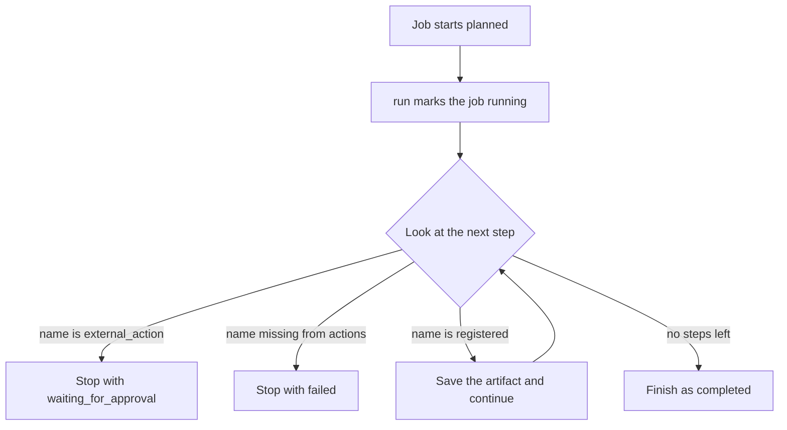

# Agentic Workflow Control Plane

A short Python example of a job that runs named steps, keeps each result on the job, and stops when it reaches a step called `external_action`. The standard library is enough. The demo returns fixed synthetic strings and stays inside the process.

## Clone

```bash
git clone https://github.com/yellowlotuscg/agentic-workflow-control-plane.git
```

## How a run works

A `Job` holds a `goal`, an ordered list of `steps`, a `state`, an `artifacts` dict, and an `events` list. A new job starts as `planned`.

`WorkflowEngine` is constructed with a dict of names to functions. `run` sets `state` to `running` and appends `started`, then walks the steps in order:

- A step named `external_action` sets `state` to `waiting_for_approval`, appends `approval_required`, and returns before any lookup in the action dict. The remaining steps are skipped.
- A name missing from the dict sets `state` to `failed`, appends `unknown_step:<name>`, and returns. The remaining steps are skipped.
- A known name calls `actions[step](job)`, stores the return value at `artifacts[step]`, and appends `completed:<step>`.
- After the last step, `state` becomes `completed` and the engine appends `completed`.

A second call to `run` on the same job starts again at the first step and appends another `started`.

`workflow/demo.py` registers two functions and runs one job:

- `research` returns `synthetic business facts`
- `draft` returns `approval-ready brief`
- goal `qualify a lead`, steps `research`, `draft`, `external_action`



## Sample run

Recorded with Python 3.12.3:

```text
$ python3 -m workflow.demo
{'state': 'waiting_for_approval', 'artifacts': {'research': 'synthetic business facts', 'draft': 'approval-ready brief'}, 'events': ['started', 'completed:research', 'completed:draft', 'approval_required']}
```

## Tests

`tests/test_engine.py` has one test. It runs the steps `a` and `external_action`, and the `a` action returns `"artifact"`. The assertions check that `state` is `waiting_for_approval` and that `artifacts["a"]` is `"artifact"`.

```text
$ python3 -m unittest discover -s tests -v
test_external_action_stops (test_engine.Tests.test_external_action_stops) ... ok

----------------------------------------------------------------------
Ran 1 test in 0.000s

OK
```

GitHub Actions (`.github/workflows/tests.yml`) runs `python -m unittest discover -s tests -v` on every push to `main` and every pull request into `main`. The job installs Python 3.12 and sets `permissions: contents: read`. The workflow file contains no secrets.

Use `python3` when that is the interpreter on your machine. The Actions runner provides `python`.

## Scope

Actions are plain functions in this process. The job lives on the `Job` object until the process exits. Approval is the `waiting_for_approval` state. The engine has no retry loop, timeout, or checkpoint file.

The [Model Context Protocol documentation](https://modelcontextprotocol.io/) describes hosts, servers, and tools. This repository is the in-process step runner above.

## License

MIT. Copyright (c) 2026 Matthew Coggins. See [LICENSE](LICENSE).
